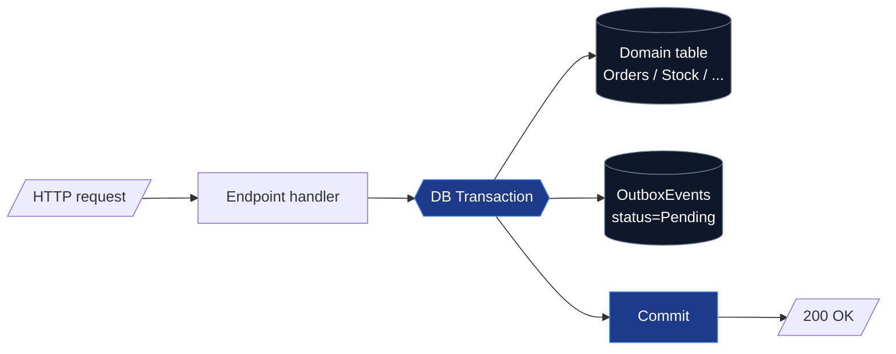
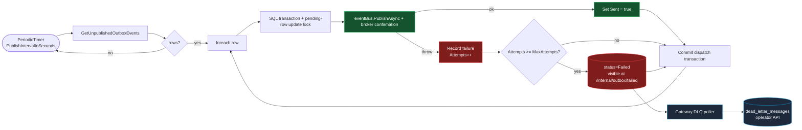
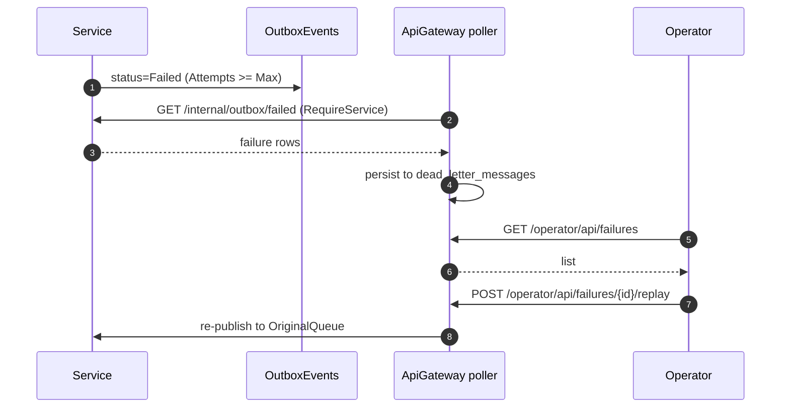

# Transactional outbox

At-least-once publish. Domain write + event row commit in one DB transaction. Background poller drains. See [ADR-0002](https://github.com/daonhan/Microservices-in-.NET/blob/main/docs/adr/0002-transactional-outbox-per-publishing-service.md).

## Write path (sync, inside HTTP request)

## Publish path (async, OutboxBackgroundService)

## Failure recovery loop

## Source

- [`shared-libs/.../Outbox/OutboxBackgroundService.cs`](https://github.com/daonhan/Microservices-in-.NET/blob/main/shared-libs/ECommerce.Shared.EventBus/Impl/Outbox/OutboxBackgroundService.cs) — poller loop
- [`shared-libs/.../Outbox/OutboxContext.cs`](https://github.com/daonhan/Microservices-in-.NET/blob/main/shared-libs/ECommerce.Shared.EventBus/Impl/Outbox/OutboxContext.cs) — EF schema
- [`api-gateway/.../OutboxPolling/OutboxFailurePoller.cs`](https://github.com/daonhan/Microservices-in-.NET/blob/main/api-gateway/ApiGateway/Infrastructure/Polling/OutboxFailurePoller.cs) — gateway-side ingest

## Replica coordination and deployment

SQL dispatch rechecks each candidate under an update lock held through publish and
state commit; competing replicas skip owned rows. RabbitMQ publishes are persistent,
mandatory, and confirmed. Delivery remains at least once. See the
[reliability deployment runbook](../runbooks/outbox-delivery-reliability.md) for
rollback/retry behavior, topology compatibility, rollout ordering, and tests.
